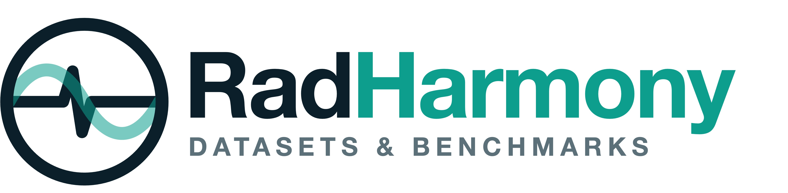

<p align="center">
  
</p>

[](https://github.com/f10409/RadHarmony/actions/workflows/tests.yml)

**RadHarmony** gives many public radiology datasets and many foundation models one interface. A harmonizer
reads the source files of a dataset and makes one harmonized table. A dataset class is a PyTorch `Dataset`
built on [MONAI](https://monai.io/), with the same sample keys for every dataset. An evaluator takes any
dataset and the encoder of a backbone recipe, and gives the same result table for all of them. Report
generation takes a report generator in place of an encoder.

Chest X-ray datasets have full support. Most CT, MRI and other radiograph datasets are beta. The
[Dataset catalog](https://f10409.github.io/RadHarmony/reference/datasets/index.html) marks them.

**Harmonize datasets:** load many sources into one format.


**Evaluate models:** probe the features of foundation-model encoders on the datasets.


## Install

RadHarmony needs Python 3.10 or newer. We recommend [uv](https://docs.astral.sh/uv/). The base install gives
the harmonizers, the dataset classes, the evaluators and PyTorch.

<!-- block: run=skip reason="installs packages" -->
```bash
git clone https://github.com/f10409/RadHarmony.git
cd RadHarmony
uv venv
source .venv/bin/activate
uv pip install -e .
```

An extra adds the packages of one backbone, the app or the notebooks. Put the name of the extra in brackets.
You can give more than one extra.

<!-- block: run=skip reason="installs packages" -->
```bash
uv pip install -e ".[raddino]"
uv pip install -e ".[model,app]"
```

Each report generator extra (`chexagent_gen`, `maira2_gen`, `medgemma_gen`) needs its own venv. The
[Install](https://f10409.github.io/RadHarmony/get-started/install.html#extras) page lists all the extras.
[More than one venv](https://f10409.github.io/RadHarmony/get-started/install.html#more-than-one-venv) lists
the extras that cannot share a venv.

The repo has Claude Code skills in `.claude/skills/` (use the package, add a dataset or a backbone, review,
fix). See [Claude Code skills](https://f10409.github.io/RadHarmony/get-started/install.html#claude-code-skills)
to use them in another project.

## Example

This block runs a linear probe with RAD-DINO features on Montgomery County CXR (138 chest X-rays, 1 label:
`tuberculosis`), with 5 folds. It needs the `raddino` extra and a GPU. Change
`/data/MontgomerySet/CXR_png/` to the folder of your images.
[Your first benchmark in 10 minutes](https://f10409.github.io/RadHarmony/get-started/first-benchmark.html)
downloads the data and runs this example step by step.

<!-- block: run=gpu timeout=600 -->
```python
from radharmony.dataset import MontgomeryCXRDataset
from radharmony.evaluator import LinearProbeEvaluator
from radharmony.evaluator.backbones import make_raddino

transform, encoder = make_raddino(device="cuda")
ds = MontgomeryCXRDataset(
    base_image_dir="/data/MontgomerySet/CXR_png/", transform=transform, output_cls=True, cache_dir=None
)
ev = LinearProbeEvaluator(encoder, dataset=ds, n_folds=5, output_dir="outputs/first_benchmark")
results = ev.evaluate()
ev.save_results(results)  # writes results.csv and results_summary.csv
print(results.groupby("label")["auroc"].mean().round(3).to_dict())
# {'macro_average': 0.971, 'tuberculosis': 0.971}
```

## Documentation

The wiki is at [f10409.github.io/RadHarmony](https://f10409.github.io/RadHarmony/index.html).

- Get started: [Install](https://f10409.github.io/RadHarmony/get-started/install.html),
  [Your first benchmark in 10 minutes](https://f10409.github.io/RadHarmony/get-started/first-benchmark.html),
  [Concepts](https://f10409.github.io/RadHarmony/get-started/concepts.html).
- How-to guides, for example
  [Load a dataset and pick outputs](https://f10409.github.io/RadHarmony/how-to/load-a-dataset.html),
  [Run a probe](https://f10409.github.io/RadHarmony/how-to/run-a-probe.html) and
  [Add a dataset](https://f10409.github.io/RadHarmony/how-to/add-a-dataset.html). The
  [wiki home page](https://f10409.github.io/RadHarmony/index.html#the-4-parts-of-this-wiki) lists all the
  guides.
- Reference: [Dataset catalog](https://f10409.github.io/RadHarmony/reference/datasets/index.html),
  [Evaluators](https://f10409.github.io/RadHarmony/reference/evaluators/index.html),
  [Backbones](https://f10409.github.io/RadHarmony/reference/backbones/index.html).

## What is in RadHarmony

- Datasets: chest X-ray datasets with labels, boxes, masks, reports or questions and answers, plus CT, MRI
  and other radiograph datasets. Examples: CheXpert, MIMIC-CXR, VinDr-CXR, PadChest, SIIM-ACR
  Pneumothorax, Montgomery County CXR, CT-RATE. The
  [Dataset catalog](https://f10409.github.io/RadHarmony/reference/datasets/index.html) lists all datasets
  and their registry keys.
- Evaluators: the linear, kNN, SVM and prototype probes, zero-shot, fine-tune, 3 segmentation heads (linear,
  conv and UPerNet), report generation and visual question answering (VQA). See
  [Evaluators](https://f10409.github.io/RadHarmony/reference/evaluators/index.html).
- Backbone recipes: a `make_<name>()` function for each model, for example `make_raddino`,
  `make_biomed_clip` and `make_medsiglip`. See
  [Backbones](https://f10409.github.io/RadHarmony/reference/backbones/index.html).
- Notebooks: the tutorials are in [`notebooks/tutorials/`](notebooks/tutorials/). Start with
  [`radharmony_hands_on.ipynb`](notebooks/tutorials/radharmony_hands_on.ipynb). The backbone comparison
  notebooks are in [`notebooks/evaluator/`](notebooks/evaluator/). The datathon26 workshop notebooks are in
  [`datathon26/`](datathon26/). Start with [`datathon26/README.md`](datathon26/README.md).
- Datathon26 module: `radharmony.datathon26` scores the embeddings and reports of an external inference
  service. See [Datathon26 module](https://f10409.github.io/RadHarmony/reference/datathon26.html).
- App: a Gradio web page shows the samples of a dataset, with the boxes and masks on the image. See
  [Use the app](https://f10409.github.io/RadHarmony/how-to/use-the-app.html).

## Contributors

The [HITI Lab](https://www.hitilab.com/) at Emory University develops and maintains RadHarmony. The
contributors are:

- **Frank Li** ([@f10409](https://github.com/f10409))
- **Bardia Khosravi** ([@BardiaKh](https://github.com/BardiaKh))
- **Judy Gichoya** ([@judywawira](https://github.com/judywawira))
- **Reza Chavoshi**
- **Theo Dapamede** ([@theodapamede](https://github.com/theodapamede))
- Other members of the HITI Lab

## Citation

If you use RadHarmony in your research, please cite:

> Li, F., Khosravi, B., Chavoshi, M., Dapamede, T., Jeon, Y., Newsome, J., Trivedi, H., & Gichoya, J. (2026). *RadHarmony: Radiological Data Handling in the Era of Agentic AI*. arXiv:2607.27235. https://arxiv.org/abs/2607.27235

```bibtex
@article{li2026radharmony,
  title   = {RadHarmony: Radiological Data Handling in the Era of Agentic AI},
  author  = {Li, Frank and Khosravi, Bardia and Chavoshi, Mohammadreza and Dapamede, Theo and Jeon, YoungSeok and Newsome, Janice and Trivedi, Hari and Gichoya, Judy},
  journal = {arXiv preprint arXiv:2607.27235},
  year    = {2026},
}
```
