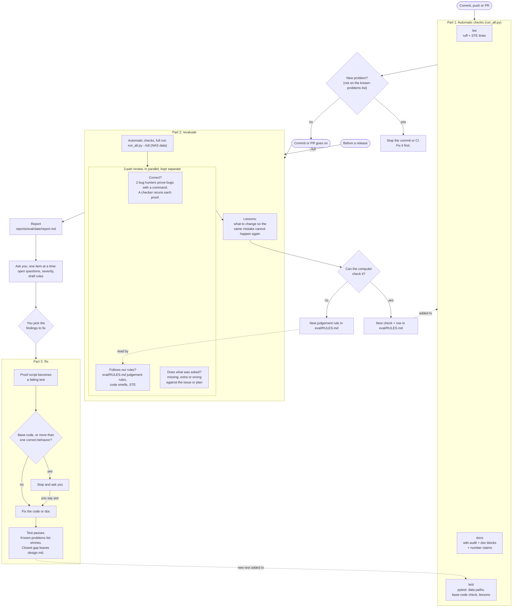

# RadHarmony evaluation pipeline

The pipeline has 3 parts.

| Part | When it runs | What it gives |
|---|---|---|
| 1. Automatic checks (`scripts/evalkit/run_all.py`) | each commit, CI, and inside `/evaluate` | pass or fail |
| 2. `/evaluate` | each branch (branch review), or the whole repo before a release (`--full`, whole-repo review) | a report with 3 review parts and lessons |
| 3. `/fix <finding ids>` | after you pick the findings to fix | fixed code or docs, each with a new test |

`eval/summary.html` explains the whole pipeline with examples. Each pipeline change updates this file and that page. If they disagree, this file is correct.

Turn on the commit hook once per clone: `git config core.hooksPath .githooks`. The commit hook checks only the staged files and skips pytest. CI runs the lint and docs groups in `checks.yml`, and pytest in `tests.yml`.

## Where the rules live

| Kind of rule | Place | Who reads it |
|---|---|---|
| A rule for every task | `CLAUDE.md` (kept short) | every agent |
| A rule the computer can check | an automatic check, plus a row in `eval/RULES.md` | the computer, at each commit |
| A judgement rule | the judgement section of `eval/RULES.md` | the Follows our rules? reviewer |
| A design decision | a D- entry in `docs/wiki/design.md` | every review agent and the checker |

## Word list

| Word | Meaning |
|---|---|
| automatic checks | checks the computer runs with no agent: `lint`, `docs`, `test` |
| known-problems list | old problems we accept for now. Only new problems fail. The list can only get shorter. |
| quick run / full run | 2 kinds of automatic-check runs. Quick run: no data, no GPU (CI). Full run (`run_all.py --full`): also runs the doc code blocks and the NAS claims (`/evaluate`). The commit hook runs a quick run on the staged files only (`--fast`). |
| branch review / whole-repo review | what `/evaluate` looks at. Branch review (default): the changes on this branch, against `main` or the `--base` branch. Whole-repo review (`--full`): every repo part. |
| bug hunter | an agent that tries to break the code and must prove each bug with a command and its output |
| checker | a second agent that reruns each proof and drops the ones that do not repeat. In a branch review, it keeps a real bug in a line that the branch did not change in a separate list. |
| finding ID | the name of one finding, for example V-H1-23. An ID always names the same finding, in every run. `reports/eval/index.json` (local only) gives the run folder of each ID. |
| old findings | open findings from the last whole-repo review. The checker reruns them and marks each one still open, fixed or cannot run. |
| review part | the 3 separate questions of the review: Correct?, Follows our rules?, Does what was asked? |
| lessons | changes to the repo so the same mistake cannot happen again |
| repo part | a group of files that one set of agents reviews in a whole-repo review, for example "Harmonizers 1" |
| design decision | a D- entry in `docs/wiki/design.md`. It is the intent that the review agents compare the code with. |
| open question | a behavior that no design decision covers. An agent writes it instead of a finding, and you decide it, one item at a time. If you leave it open, it becomes a D- entry with the status "Open". |
